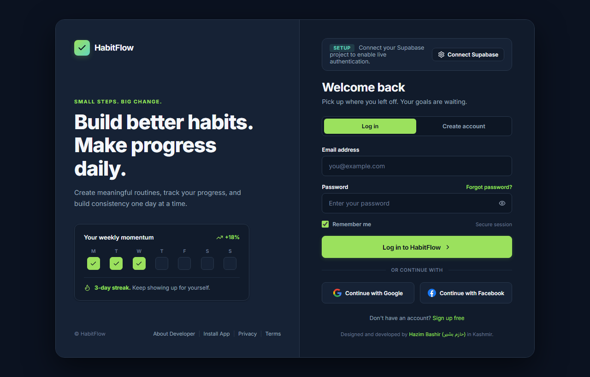
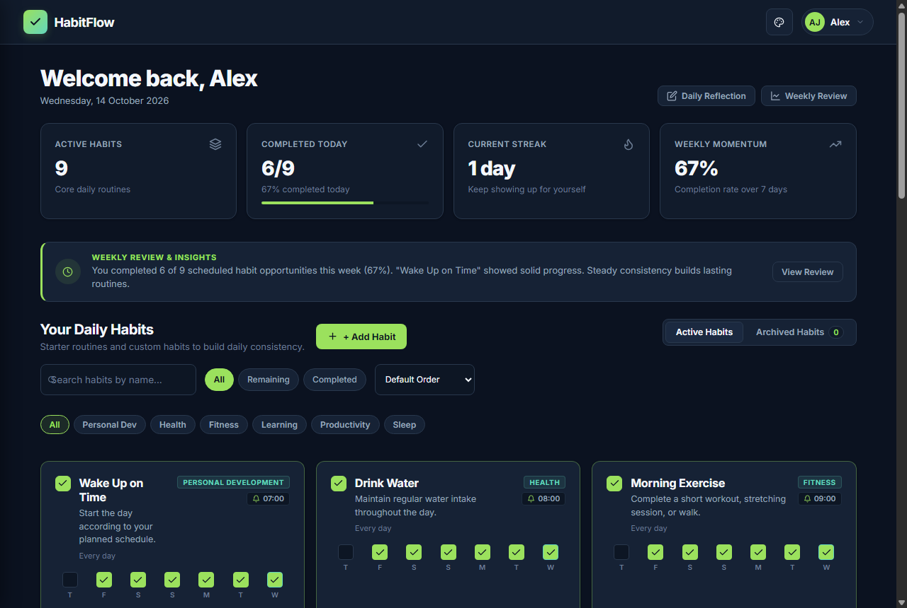
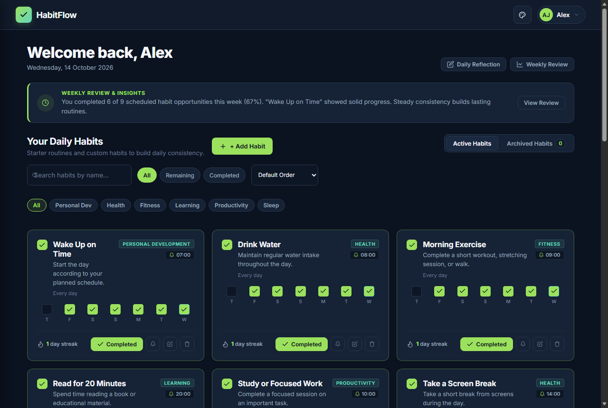
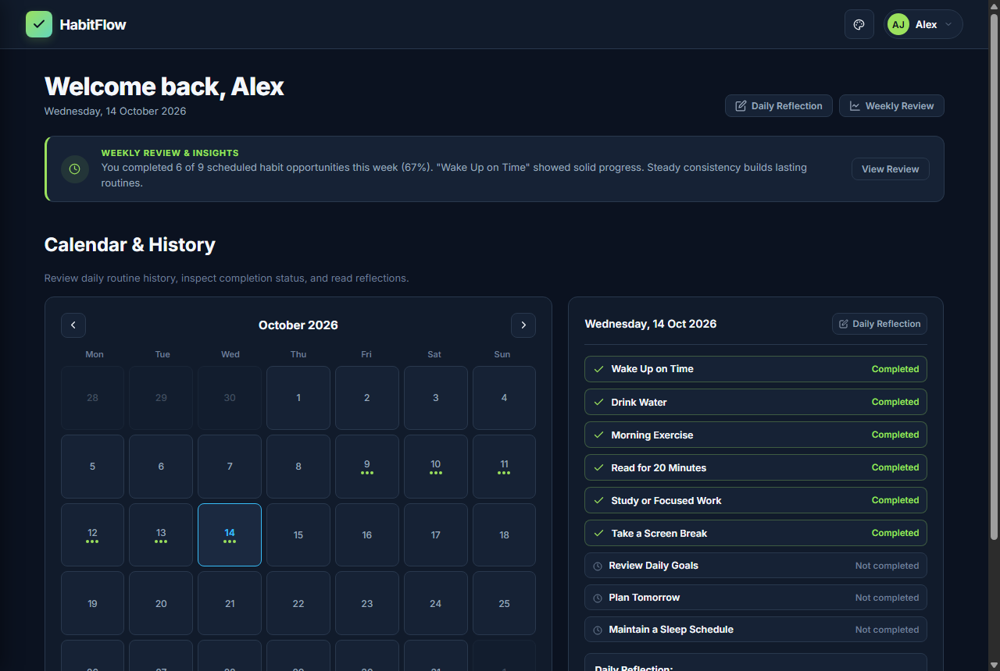
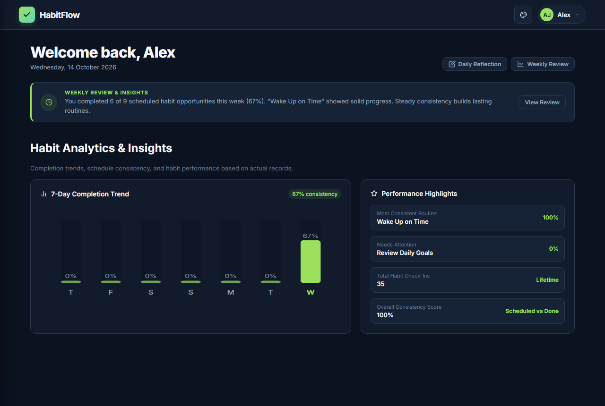
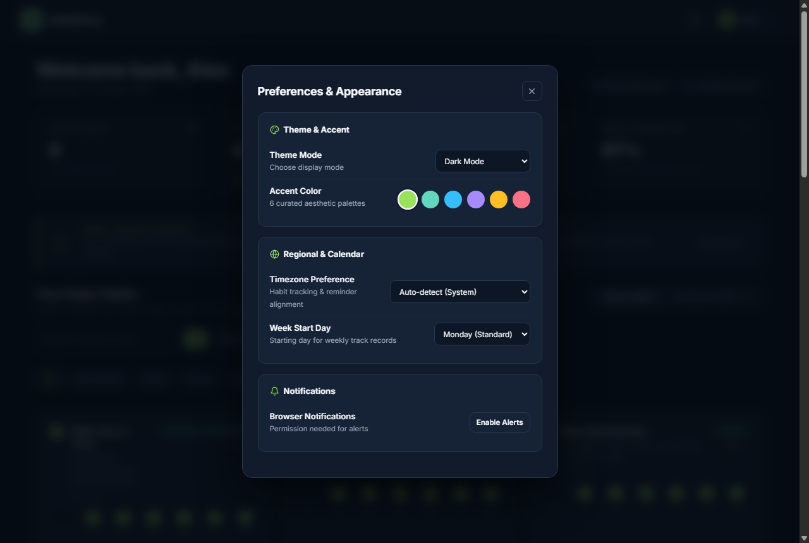
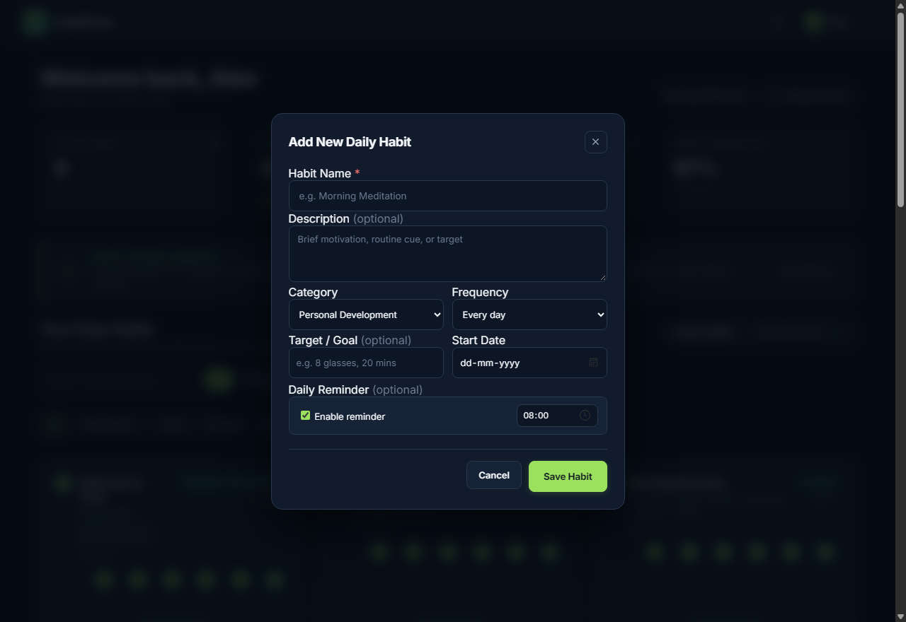

<div align="center">


# HabitFlow

### Build Better Habits. Track Your Progress. Stay Consistent.

A modern, responsive, and privacy-first Progressive Web App (PWA) designed to organize daily routines, track completion consistency, visualize progress analytics, and maintain mindfulness reflections.

[](#technology-stack)
[](#environment-configuration)
[](#features)
[](#deployment)

</div>

---

## Overview

**HabitFlow** is an offline-capable habit tracker that combines structured daily discipline with actionable analytics. Whether starting with preconfigured morning routines or crafting tailored productivity workflows, HabitFlow equips you with schedule-aware streak tracking, completion heatmaps, evening reflections, and multi-platform PWA installation across desktop and mobile devices.

The application operates with zero build compilation dependencies, relying entirely on modern ES6+ JavaScript modules, custom CSS variables, and Supabase Row Level Security (RLS) database policies.

---

## Screenshots

### 1. Authentication & Overview

<table>
  <tr>
    <td width="50%" align="center">
      <b>Authentication Portal</b><br />
      <sub>Email/password validation, Google OAuth, Facebook OAuth, and password recovery</sub>
    </td>
    <td width="50%" align="center">
      <b>Main Dashboard</b><br />
      <sub>Personalized greeting, today's completion ring, streak count, and momentum card</sub>
    </td>
  </tr>
  <tr>
    <td>
      
    </td>
    <td>
      
    </td>
  </tr>
</table>

### 2. Routine Execution & Calendar Matrix

<table>
  <tr>
    <td width="50%" align="center">
      <b>Daily Habits Checklist</b><br />
      <sub>Category filter pills, real-time search, sort controls, and 7-day mini trackers</sub>
    </td>
    <td width="50%" align="center">
      <b>Calendar & Habit History</b><br />
      <sub>Interactive monthly matrix with completion dots and detailed daily inspection drawer</sub>
    </td>
  </tr>
  <tr>
    <td>
      
    </td>
    <td>
      
    </td>
  </tr>
</table>

### 3. Analytics, Preferences & Management

<table>
  <tr>
    <td width="50%" align="center">
      <b>Statistics & Analytics</b><br />
      <sub>7-day completion trend chart, weekly review banner, and performance highlights</sub>
    </td>
    <td width="50%" align="center">
      <b>Preferences & Appearance</b><br />
      <sub>Theme selection (Dark, Light, System), 6 accent swatches, and notification controls</sub>
    </td>
  </tr>
  <tr>
    <td>
      
    </td>
    <td>
      
    </td>
  </tr>
</table>

<div align="center">
  <b>Habit Management & Scheduling</b><br />
  <sub>Create and customize routines with target quantities, custom active days, and reminder alarms</sub>
  <br /><br />
  
</div>

---

## Features

- **Authentication & Account Security**:
  - Secure Email and Password authentication powered by Supabase.
  - Social OAuth sign-in supporting Google and Facebook.
  - 3-step secure password recovery and reset workflow.
  - Strict client-side credential separation using public anonymous keys and PostgreSQL Row Level Security (RLS).
- **Habit Tracking & Daily Execution**:
  - 9 preconfigured starter habits provisioned automatically upon initial sign-up.
  - Custom habit creation with target quantities, descriptions, and category tags.
  - Customizable frequencies: Every day, Weekdays (Mon-Fri), Weekends (Sat-Sun), or Custom Day selection.
  - Schedule-aware streak calculation preserving momentum across planned rest days.
  - Fast search, category filter pills, status toggles (All, Remaining, Completed), and sorting.
- **Calendar & Completion History**:
  - Interactive monthly calendar matrix with completion status indicators.
  - Day Details inspection drawer displaying exact habits completed and reflections recorded for any chosen date.
- **Analytics & Weekly Review**:
  - Dynamic 7-day completion trend visualization.
  - Weekly review insights calculating completion consistency and identifying routines requiring focus.
  - Performance highlights tracking lifetime check-ins and top routines.
- **Daily Mindfulness Reflections**:
  - Dedicated daily reflection modal capturing wins, challenges, and tomorrow's improvements.
- **Personalization & Accessibility**:
  - Theme switching: Dark Mode, Light Mode, and System Preference.
  - 6 curated accent color palettes: Emerald, Teal, Sapphire, Violet, Amber, and Coral.
  - Regional customization: Timezone detection and Week Start Day configuration.
  - Clean typography using Google Fonts (Inter) and custom inline Lucide-style SVG icons with strict zero emojis.
- **Progressive Web App (PWA)**:
  - Installable standalone application for Windows, macOS, Android, and iOS.
  - Service Worker providing asset caching and offline resilience.
  - Interactive multi-platform installation guide with step-by-step instructions for Desktop, Android, and iOS Safari.
- **Data Export & Portability**:
  - One-click client-side export in JSON and CSV formats.

---

## Technology Stack

| Layer | Technologies |
| :--- | :--- |
| **Frontend Core** | Vanilla JavaScript (ES6+ Modules), HTML5 Semantic Architecture |
| **Styling & Design** | Modern Vanilla CSS, CSS Variables, Flexbox, CSS Grid |
| **Icons & Media** | Custom inline SVG icons (Lucide-inspired design system) |
| **Backend & Auth** | [Supabase](https://supabase.com/) (PostgreSQL, Row Level Security, GoTrue Auth) |
| **PWA & Offline** | W3C Web App Manifest (`manifest.webmanifest`), Service Worker API |
| **Local Server** | Zero-dependency Node.js HTTP server (`server.js`) |
| **Production Bundler** | Production isolation build script (`build.js`) |
| **Cloud Deployment** | Cloudflare Workers Static Assets (`wrangler.jsonc`, Wrangler CLI) |

---

## Project Structure

```
HabitFlow/
├── index.html                  # Root landing page and authentication session router
├── habitflow_auth.html         # Login, registration, and social OAuth portal
├── dashboard.html              # Main user dashboard, habit checklists, and calendar
├── reset-password.html         # Dedicated password recovery and token update interface
├── server.js                   # Zero-dependency local Node.js development server
├── build.js                    # Production asset isolation script (outputs to ./dist)
├── wrangler.jsonc              # Cloudflare Workers Static Assets configuration
├── package.json                # Project scripts, metadata, and dependencies
├── .gitignore                  # Git exclusion rules for secrets, node_modules, and cache
├── .env.example                # Environment variable template with placeholder keys
├── manifest.webmanifest        # PWA Web App Manifest
├── manifest.json               # Secondary PWA manifest alias
├── sw.js                       # Service Worker implementing Cache-First offline strategy
├── generate_pwa_icons.js       # Vector-to-raster generator for app icons
├── capture_all_screenshots.js  # Automated headless screenshot capture suite
├── README.md                   # Project documentation and visual showcase
├── screenshots/                # Showcase application screenshots
│   ├── 01-login-auth.png
│   ├── 02-main-dashboard.png
│   ├── 03-daily-habits.png
│   ├── 04-calendar-history.png
│   ├── 05-statistics-analytics.png
│   ├── 06-preferences-appearance.png
│   └── 07-habit-management.png
├── assets/
│   ├── css/
│   │   ├── styles.css          # Design system tokens, toasts, and global PWA modal
│   │   ├── auth.css            # Authentication form layouts and responsive shell
│   │   ├── dashboard.css       # Habit cards, analytics charts, calendar drawer
│   │   └── developer-modal.css # Developer profile modal and social links grid
│   ├── js/
│   │   ├── config.js           # Runtime environment and client credential manager
│   │   ├── supabase-client.js  # Supabase client initialization & OAuth handlers
│   │   ├── auth.js             # Authentication form lifecycle controller
│   │   ├── dashboard.js        # Habit CRUD, completions, reflections, and stats
│   │   ├── validation.js       # Input validators and security checks
│   │   ├── pwa.js              # PWA manager and multi-platform install guide
│   │   ├── profile.js          # Developer profile modal interactions
│   │   ├── theme.js            # Theme switching and storage persistence
│   │   └── reset-password.js   # Recovery token and password update controller
│   └── icons/                  # 192px, 512px, maskable, and Apple touch icons
├── pages/
│   ├── privacy.html            # Transparent privacy policy
│   └── terms.html              # Terms of Service
└── supabase/
    └── schema.sql              # PostgreSQL schema, RLS policies & automatic triggers
```

---

## Installation & Local Development

### Prerequisites

- [Node.js](https://nodejs.org/) (version 18 or newer recommended)
- A modern web browser (Google Chrome, Microsoft Edge, Safari, or Mozilla Firefox)

### Setup Instructions

1. **Clone the repository**:
   ```bash
   git clone https://github.com/officialhazim42/HabitFlow.git
   cd HabitFlow
   ```

2. **Install development dependencies**:
   ```bash
   npm install
   ```

3. **Configure environment variables**:
   ```bash
   cp .env.example .env
   ```
   Provide your Supabase URL and public Anonymous Key in `.env` (or configure them directly in-app using the Developer Setup banner).

4. **Start the local development server**:
   ```bash
   npm start
   ```
   Open your browser at `http://localhost:3000/`.

5. **Run automated test suites**:
   ```bash
   # Run core test suite and PWA verification
   npm test

   # Run all regression and integration suites
   npm run test:all
   ```

6. **Build for production**:
   ```bash
   npm run build
   ```
   This generates the isolated distribution in `./dist`, verifying that all assets are within size limits and excluding development tooling.

---

## Environment Configuration

HabitFlow requires connection to a Supabase project for live multi-device authentication and database persistence.

### Required Variables (`.env`)

```ini
# Supabase Project URL (from Project Settings -> API)
SUPABASE_URL="https://wzeuroydrorelcxprgew.supabase.co"

# Supabase Public Anonymous Key (safe for frontend client use)
SUPABASE_ANON_KEY="eyJhbGciOiJIUzI1NiIsInR5cCI6IkpXVCJ9.your-anon-key-here"

# OAuth Callback URL (Defaults to window.location.origin)
AUTH_REDIRECT_URL="http://localhost:3000/dashboard.html"
```

> **Security Guarantee**: Never include `SUPABASE_SERVICE_ROLE_KEY` or OAuth client secrets in frontend code or repository files. HabitFlow operates exclusively using public tokens safeguarded by Row Level Security (RLS) policies defined in `supabase/schema.sql`.

---

## Deployment

### Cloudflare Workers Static Assets

HabitFlow is preconfigured for deployment on Cloudflare Workers Static Assets:

1. **Configuration**: Configured via `wrangler.jsonc` pointing `"assets": { "directory": "./dist" }`.
2. **Build & Deploy**:
   ```bash
   npm run deploy
   ```
   *(Executes `npm run build` followed by `wrangler deploy` to publish `./dist` globally.)*

### Static & Jamstack Hosting (Vercel, Netlify, Cloudflare Pages)

- **Build Command**: `npm run build`
- **Output Directory**: `dist`
- **Headers**: Cloudflare `_headers` is automatically generated in `dist/` with `Service-Worker-Allowed: /` and PWA caching directives.

---

## License & Attribution

All rights reserved. Copyright &copy; **Hazim Bashir (حازم بشیر)**.

Designed and developed by **Hazim Bashir (حازم بشیر)** — `@officialhazim42` in Kashmir.
- **GitHub**: [@officialhazim42](https://github.com/officialhazim42)
- **LinkedIn**: [hazim-bashir-faqeer](https://www.linkedin.com/in/hazim-bashir-faqeer)
- **Email**: [hazimbashirfaqeer@gmail.com](mailto:hazimbashirfaqeer@gmail.com)
